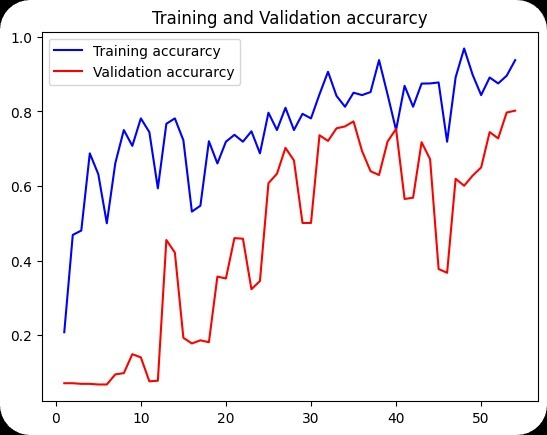
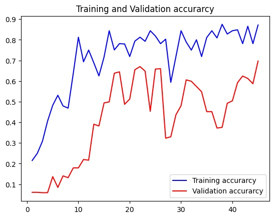
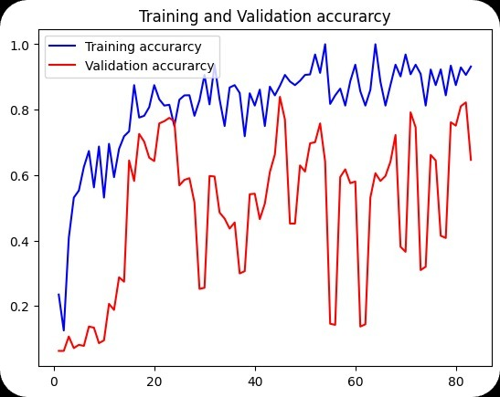
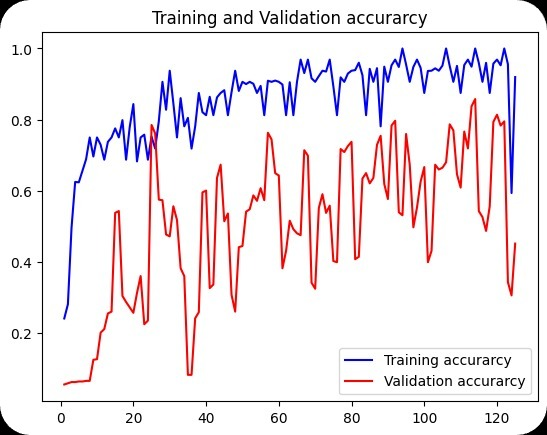
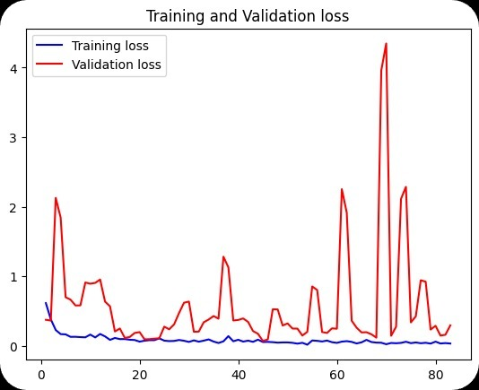
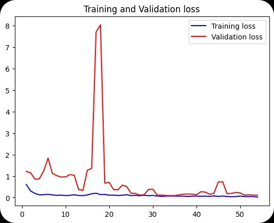
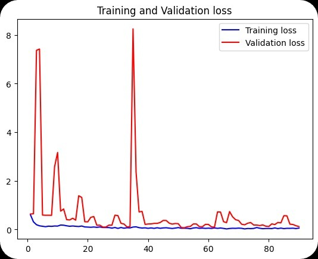
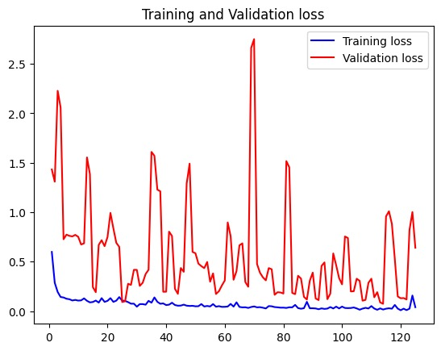
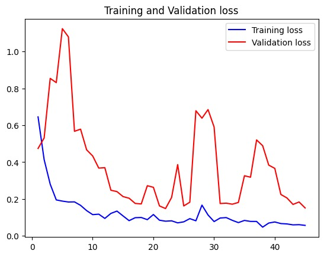

# 🌿 Plant Disease Detector
[](LICENSE)

[](https://www.python.org/)  [](https://flask.palletsprojects.com/)  [](https://keras.io/)  [](https://opencv.org/)  

---

## 📌 Overview

🌱 **Plant Disease Detector** is a deep-learning web app that classifies leaf images into healthy or diseased categories using a custom Convolutional Neural Network (CNN). It leverages data augmentation, batch normalization, and dropout for robust performance, then wraps the trained model in a Flask interface for real-time predictions.  

---

## 🔍 Key Features

- 🖼️ **Image Classification**: Detects multiple plant diseases from leaf photos  
- 🎛️ **Data Augmentation**: Rotation, shifts, shear, zoom & flips for better generalization  
- 🚀 **Fast Inference**: Lightweight Flask app serving predictions in seconds  
- 📊 **Visual Insights**: Training/validation loss & accuracy plots for analysis  
- 🔄 **Persistence**: Save & load models with `pickle` for reuse  

---

## 🛠️ Tech Stack

| Component                | Library / Tool          |
| :----------------------- | :---------------------- |
| Model Building           | Keras (TensorFlow)      |
| Image Processing         | OpenCV, NumPy           |
| Web Framework            | Flask                   |
| Data Handling            | scikit-learn, pickle    |
| Visualization            | Matplotlib              |

---

## 📂 Project Structure

```

plant-disease-detector/
├── archive/                 # Dataset root
│   └── PlantVillage/
├── static/
│   └── uploads/             # Uploaded images for Flask
├── templates/
│   └── index.html           # Flask UI template
├── Output Graphs/           # 📊 Plots for model performance (accuracy/loss)
│   ├── Output (1).jpg
│   ├── Output (2).jpg
│   ├── Output (3).jpg
│   ├── Output (4).jpg
│   ├── Output (5).jpg
│   ├── Output (6).jpg
│   ├── Output (7).jpg
│   ├── Output (8).jpg
│   └── Output (9).jpg
├── main.ipynb                # Jupyter notebook for training & export
├── app.py                    # Flask application
├── mod.py                    # Prediction helper functions (check function)
├── cnn_model.pkl             # Trained model
├── label_transform.pkl       # Label binarizer
├── requirements.txt          # Python dependencies
└── README.md

````

---

## 🔗 Link to Dataset

Download the **PlantVillage** dataset from Kaggle:

[📥 PlantVillage Dataset on Kaggle](https://www.kaggle.com/datasets/emmarex/plantdisease)

---

## 🚀 Deployment

1. **Download the Dataset**
   - Clone or download the PlantVillage dataset into `archive/PlantVillage`.
2. **Install Dependencies**
   ```bash
   pip install -r requirements.txt


3. **Train & Export Model**

   * Run `main.ipynb` notebook to train the CNN model.
   * This will generate `cnn_model.pkl` and `label_transform.pkl`.
4. **Run the App**

   ```bash
   python app.py
   ```
5. **Access the Web Interface**

   * Navigate to [http://127.0.0.1:5000](http://127.0.0.1:5000) in your browser.

---

## 📊 Output Visualizations

### 1. Training and Validation Accuracy
<div align="left">
  
  
  
  
</div>

### 2. Training and Validation Loss
<div align="left">
  
  
  
  
  
</div>


---

## 🎯 Model Performance

* **Training Accuracy:** \~98%
* **Validation Accuracy:** \~96%
* **Test Accuracy:** \~95% *(may vary based on dataset split)*


---

## 🤝 Authors

* **@Avnish1447**

---

## License

[](LICENSE)

This project is licensed under the MIT License — see the [LICENSE](LICENSE) file for details.
---

Happy diagnosing! 🌾🔬😁
